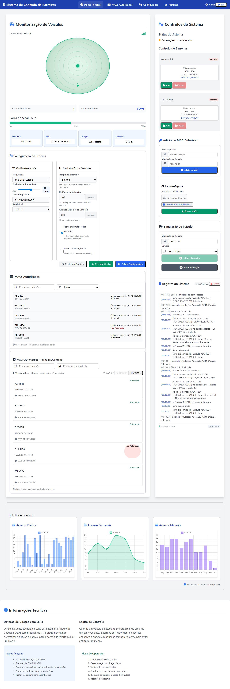
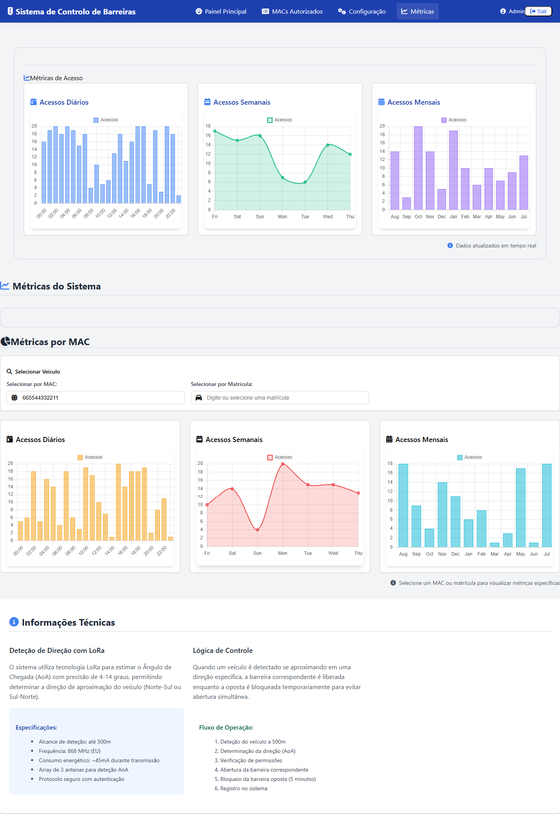
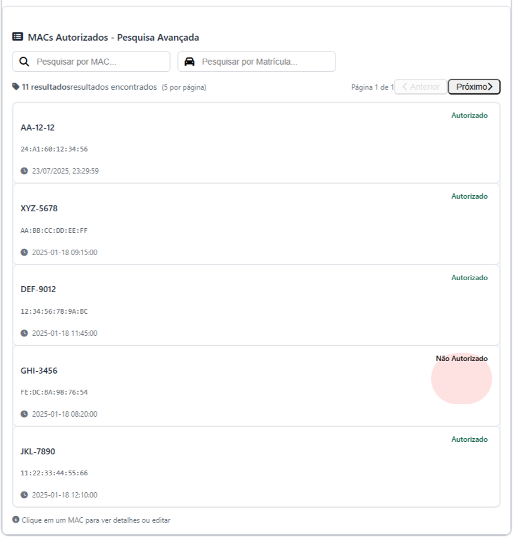

# 🚀 IOT Access Control & Barrier Management System



## 🎯 Visão Geral
O **IoT Access Control** é um projeto de integração entre uma aplicação Web, firmware ESP32 e comunicação LoRa para explorar a gestão de barreiras físicas e o monitoramento de acessos veiculares. As capacidades descritas dependem da configuração, do hardware e de validação em ambiente real; este repositório não constitui, por si só, uma certificação de segurança ou uma garantia de alcance.

---

> **Estado do projeto:** protótipo/implementação em evolução. As funcionalidades, imagens e valores apresentados devem ser confirmados no hardware e ambiente de execução antes de serem considerados validados. Não utilizar em controlo de acessos crítico sem análise de risco, testes de segurança, mecanismos fortes de autenticação e procedimentos de contingência.

## ✨ Funcionalidades
- **📡 Comunicação LoRa**: prototipagem de comunicação de longo alcance na banda configurada; o alcance efetivo deve ser medido no local e depende de antenas, potência permitida, obstáculos e interferência.
- **🛡️ Controlo por MAC**: mecanismo adicional de identificação/filtragem de dispositivos; endereços MAC podem ser falsificados e não devem ser usados como único mecanismo de autenticação.
- **📊 Dashboard operacional**: visualização de métricas, estado de ligação e registos de atividade, conforme a integração disponível.
- **🎯 Detecção Direcional**: Cálculo de trajetória (NS/SN) para automação inteligente de abertura.
- **📱 PWA Ready**: Interface adaptativa instalável com suporte a modo offline.
- **🔍 Simulação de Hardware**: Ambiente de teste integrado para validar lógicas sem dispositivos físicos.

---

## 🛠️ Stack Tecnológica

### **Backend & API**


### **Frontend**


### **Hardware & Firmware**


---

## 📸 Screenshots

### **Painel de Controle Central**

*Gestão completa de acessos e monitoramento de saúde do sistema.*

### **Métricas de Performance**

*Gráficos detalhados sobre o fluxo de veículos e horários de pico.*

### **Gestão de Dispositivos**

*Whitelist de endereços MAC para controle de acesso seguro.*

---

## 🚀 Guia de Instalação

### **1. Ambiente Web (Backend)**
```bash
# Clone o repositório
git clone https://github.com/smpsandro1239/IOT.git
cd IOT/backend

# Instale dependências
composer install

# Configure o ambiente
cp .env.example .env
php artisan key:generate

# Execute as migrações e seeders
php artisan migrate --seed
```

### **2. Firmware (Hardware)**
1. Abra a pasta `base/` na **Arduino IDE**.
2. Instale as bibliotecas: `Heltec ESP32`, `ArduinoJson`, `LoRa`.
3. Configure as credenciais WiFi no arquivo `credentials.h`.
4. Realize o upload para o módulo **Heltec WiFi LoRa 32 V2**.

---

## 📦 Scripts de Utilidade (Windows)
O projeto inclui automações para facilitar o desenvolvimento:
- ⚡ `iniciar_sistema_otimizado.bat`: Sobe o ambiente completo (Laravel + PHP Server).
- 🧪 `teste_configuracao.bat`: Valida se todos os pré-requisitos estão ativos.
- 🧹 `clear_cache.bat`: Limpa caches do Laravel e otimiza o sistema.

---

## 📄 Licença
Distribuído sob a licença MIT. Veja `LICENSE` para mais informações.

---

**Desenvolvido para alta performance e estabilidade operacional.** 🚀
